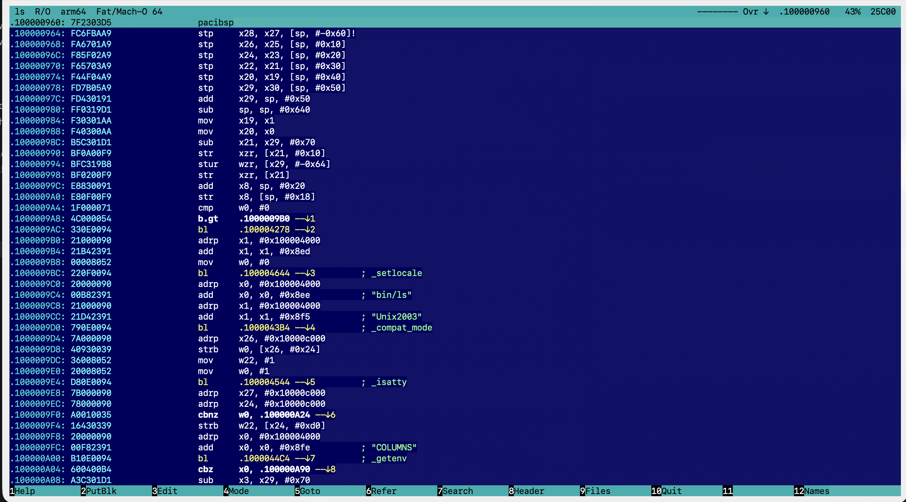
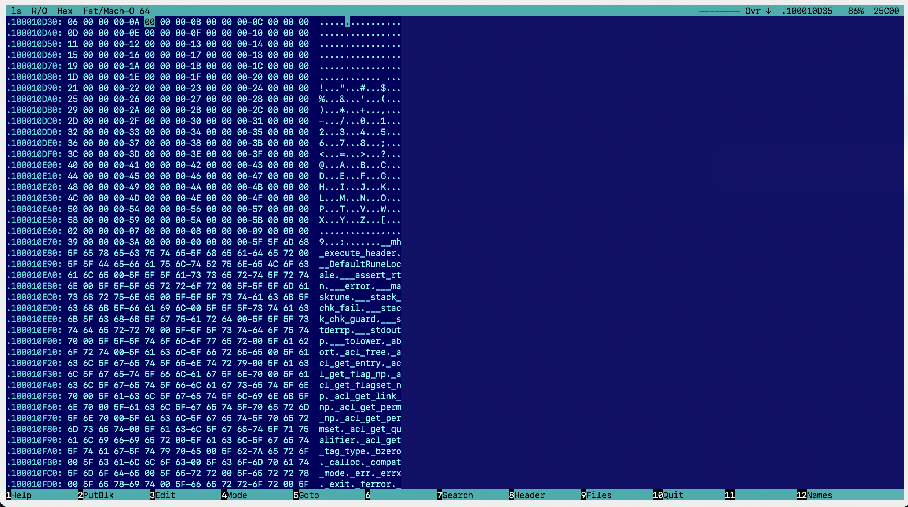

# Hiew — cross-platform Hacker's View

A console hex viewer, hex editor and disassembler with the modes, hotkeys and blue screen of **Hiew (Hacker's View)**.
Runs on macOS, Linux and Windows.



*Decode mode on `/bin/ls` (arm64 slice of a universal Mach-O), at the entry point.*



*Hex mode on the same file: address, 16 bytes in hex, the same bytes as characters.*

## Installation

Requires Python 3.8+.

```sh
pip install .                    # macOS / Linux / Windows (windows-curses is pulled in on Windows)
brew install keystone            # assembler (F3 → F2) on macOS; Linux: libkeystone, Windows: pip install keystone-engine
hiew file.exe
```

Without installing: `pip install capstone` (plus `windows-curses` on Windows), then `python -m hiew file`.

Command-line options:

| Option | What it does |
|---|---|
| `-m text\|hex\|decode` | start mode |
| `-o 1234` / `-o .401000` / `-o main` | start position: file offset, virtual address or symbol name |
| `-e` | open the entry point in Decode mode |
| `-s x86_64` / `--slice 1` | universal (fat) Mach-O: which slice to open, by CPU name or number. Inside the program use F4, or Enter on a slice line in F8 |
| `-a x86-64` | disassembler architecture (x86-16/32/64, arm, thumb, arm64, mips32/64, ppc32/64, riscv32/64) |
| `-t hiew\|blue\|dark\|light` | colour theme: `hiew` deep navy (default), `blue` DOS blue, `dark`, `light`. F4 switches it live; the choice is remembered in `~/.config/hiew/settings.json` |
| `--colors 8` | 8-colour variant of the theme, for terminals without 256 colours |
| `--no-mouse` | don't capture the mouse, so the terminal can select text |
| `--no-modpoll` / `--no-kitty` | don't read modifier keys from the OS / don't enable the kitty keyboard protocol |
| `--keys` | keyboard test: shows the raw bytes of every key press and how hiew reads them |
| several files / a wildcard | `hiew a.exe b.dll` or `hiew *.exe`: Ctrl+F11 / Ctrl+F12 switch between them |

## Hotkeys

The key map follows the [Hiew Documentation Project](https://taviso.github.io/hiewdocs/). The same reference is
available in the program with `F1`.

### Modes

| Key | Action |
|---|---|
| `Enter` | Text → Hex → Code → Text (the address is kept) |
| `F4` | menu: modes, architectures, codepages, themes; slices of a universal (fat) Mach-O |
| `F3` | edit mode (EDITMODE): Esc leaves without writing, F9 writes |
| `Ctrl+F1` | code size: 16 / 32 / 64 bit |
| `Shift+F1` | architecture (x86, ARM, ARM64, MIPS, PPC, RISC-V) |
| `Alt+F1` | addresses: file offset ↔ virtual address (.VA) |

### Navigation

| Key | Action |
|---|---|
| `Ctrl+Home` / `Ctrl+End` | start / end of file |
| `F5` | goto: `1234` (hex), `123t` (decimal), `.401000` (VA), `+100`, `-10t`, a name; PgDn in the dialog shows the history |
| `F6` / `Ctrl+F6` | (Code) first / next reference to the current address |
| `1..9`, `A..Z` | (Code) follow the jump marked on screen (`--↓1`) |
| `/` | (Code) resynchronise the disassembly at the cursor |
| `BkSp` | go back |
| `Shift+F9/F10/F11` | follow the dword / qword / word under the cursor |
| `Alt+F11` / `Alt+F12` | follow the word / dword under the cursor |

### Bookmarks (8 per mode, shown in the status bar)

| Key | Action |
|---|---|
| `+` | save the position |
| `-` | return to the current bookmark (marked ♦) |
| `Alt+1..Alt+8` | go to a bookmark by number |
| `Alt+-` | delete the current bookmark |
| `Alt+0` | delete all bookmarks |

### Blocks

| Key | Action |
|---|---|
| `*` | start a block, move the cursor (F5, F7, Ctrl+End … work too), `*` ends it; `*` on a finished block clears it. From Text mode it switches to Hex |
| `Shift+arrows`, `PgUp`/`PgDn`, `Home`/`End` | select a block from the cursor (Hex/Code) |
| `Ctrl+*` | the whole file becomes the block |
| `Alt+*` | move the start of the block to the cursor |
| `[` / `]` | go to the start / end of the block |
| `Ins` | block operations insert (the file grows) or overwrite |
| `F2` | write the block to a file (PutBlk) |
| `Ctrl+F2` | read a file into the current position (insert or overwrite) |
| `Alt+F2` | fill the block with a pattern; in Code view without a block, NOP the current instruction |
| `Alt+F3` | Crypt: run a routine in a small x86 subset over the block |
| `Shift+F2` | delete the block from the file |
| `Shift+F3` | insert N zero bytes |
| `Shift+F4` | print the block (hex dump) to a file or the clipboard |
| `Shift+F5` / `Shift+F6` | copy / move the block to the cursor |
| `Alt+M` / `Shift+Alt+M` | colour the block (pick a colour / random), saved to `<file>.cmarkers` |
| `Alt+N` / `Shift+Alt+N` | go to the next / previous coloured block |

### Search

| Key | Action |
|---|---|
| `F7` | search. In the dialog: Tab Hex/ASCII, F2 direction, F3 case, F4 file/block, F6 UTF-16 even/odd, F7 search for an instruction (assembler), Alt+? any character; `??` in Hex is any byte; typing more than 3 non-hex characters into Hex switches to ASCII |
| `Ctrl+Enter`, `Shift+F7` | next match (without a previous search the dialog opens) |
| `Alt+F7` | change the direction (arrow in the status bar) |
| `Alt+F8` | character table: codepage, UTF-16 (unicode) |
| `Alt+F6` | strings: `+`/`-` minimum length, F6 type (ASCII, UTF-16 even/odd), F2 offsets, F9 filter, typing filters too |
| `Ctrl+F3` | search and replace: Y / N / A (all). "All" scans the file once with progress (Esc stops), asks for confirmation with the number of matches and is undone by one Ctrl+Z |

### Editing (F3)

| Key | Action |
|---|---|
| `0-9 A-F` | hex digits (in Hex and directly in Code, which re-disassembles live); Tab switches Hex ↔ characters (Hex) or line-by-line assembler (Code) |
| `F2`, `Enter` (Code) | assembler (numbers are hex, `10t` is decimal); in Code you can start typing an instruction beginning with g–z (`nop`, `mov`, `jmp`); a–f are hex digits there |
| `F3` | restore the original byte under the cursor; `Ctrl+Z` undoes the last change |
| `F4` / `F5` / `F6` | bit editor for byte / word / dword |
| `F7`, `Ctrl+F7` | Crypt at the cursor / set the routine, e.g. `mov al, cl ; add cl, 1` |
| `F8`, `Ctrl+F8` | XOR / set the key |
| `Alt+F2` | NOP the current instruction, or fill the block |
| `F10` | truncate the file at the cursor |
| `F9` / `Esc` | write / discard |

Edits live in memory until F9; the file is not touched before that.

### Files and names

| Key | Action |
|---|---|
| `F9` | open a file; `Tab` switches to the next open file |
| `Ctrl+F11` / `Ctrl+F12` | previous / next file from the command line |
| `Ctrl+BkSp` | list of open files (Enter, Del) |
| `Alt+F10` | close the file and return to the previous one |
| `Alt+F4`, `Ctrl+F4` | reload the file |
| `F8` | header; inside it F5 entry point, F6 sections, F7 imports (Enter finds the calls, Ctrl+Enter the next one), F9 exports, Enter on a slice line switches the slice |
| `F12` | names and comments; inside the window F12 imports, Shift+F12 exports a text file |
| `Shift+F12` | name the current location; `;` adds a comment (both are saved to `<file>.hnames`) |

### Miscellaneous

| Key | Action |
|---|---|
| `Alt+=` | calculator: hex by default, `10t`, `17o`, `101i`; `@b @w @d @q` (`@B` … unsigned) read data at the cursor, `@o` / `@O` address / offset; Up/Down move the window |
| `Alt+P` | screenshot to a file or the clipboard |
| `Alt+B` | beeps on / off |
| `Ctrl+Alt` (hold) | information about the file and the system (`Alt+I` shows it in a window) |
| `Ctrl+.` / `Ctrl+0..8` | record / play a macro; `Ctrl+-` lists the macros |
| `Esc` | quit without changing the file timestamp; `F10` quits and updates it |
| `F11` | HEM modules are not supported |

### When the terminal doesn't send a key combination

| Key | Action |
|---|---|
| `Ctrl+X`, then a key | sticky modifier: each Ctrl+X cycles Alt → Ctrl → Shift; the bottom bar shows that layer's labels |
| `Esc`, then a key | within 0.5 s, the same as Alt+key |
| bottom bar | while Alt / Ctrl / Shift is held it shows that layer's labels (kitty keyboard protocol, or the modifier state read from macOS / Windows / X11) |

### macOS: Ctrl+F1…F8 and function keys

macOS reserves Ctrl+F1…F8 for keyboard navigation (System Settings → Keyboard → Keyboard Shortcuts → Keyboard:
"Turn keyboard access on or off", "Move focus to the menu bar / Dock / window …"). Turn those shortcuts off and
Ctrl+F1 (code size), Ctrl+F2 (GetBlk), Ctrl+F3 (replace), Ctrl+F6 (next reference) and Ctrl+F7 (find next) reach hiew.

Terminal.app sends nothing for Ctrl+F-keys in its default keyboard profile; add the xterm sequences
(`\033[1;5P` … `\033[24;5~`) under Profiles → Keyboard. Without Fn the Mac function keys act as media keys: press Fn
or enable "Use F1, F2, etc. keys as standard function keys". In Terminal.app also enable "Use Option as Meta key".

## What is supported

- **Formats:** PE32/PE32+ (x86, x64, ARM, ARM64) with imports and exports; ELF32/64 (LE/BE) with symtab/dynsym,
  GOT slot names, PLT stubs and DT_NEEDED libraries; Mach-O 32/64 and universal (fat) binaries with imports
  (stubs / GOT via the indirect symbol table), exports and libraries; DOS MZ. Other files open as raw data.
- **Disassembler:** capstone — x86-16/32/64, ARM/Thumb, ARM64, MIPS, PowerPC, RISC-V. Branch targets are shown as
  Hiew addresses (`.00401234`), `[rip+X]` is resolved to an absolute address, ARM64 `adrp` + `add`/`ldr` pairs
  are resolved too. Comments show import and symbol names, `@plt` stubs and the strings (ASCII and UTF-16) the code
  refers to.
- **Reference search (F6, imports):** byte-pattern scanning confirmed by the disassembler instead of disassembling the
  whole file — x86 `call`/`jmp`/`jcc`, `[rip+X]`, absolute addresses and jump tables; ARM64 B/BL, B.cond, CBZ/TBZ,
  ADR, literal loads and ADRP pairs. Counts match `otool` on large libraries; about 3 s on a 285 MB `libclang.dylib`.
- **Large files** are memory-mapped and never read into memory as a whole; edits are kept as patches.

## Code layout

| File | Contents |
|---|---|
| `hiew/app.py` | user interface: modes, drawing, dialogs, keys |
| `hiew/spec.py` | the hiewdocs key map: bookmarks, macros, block colours, insert mode, search, references, files, names, calculator |
| `hiew/extra.py` | Hiew 7 commands: blocks, Crypt, bit editor, XOR, replace |
| `hiew/keys.py` | key decoding for xterm, kitty, macOS and Windows (PDCurses) |
| `hiew/mods.py` | Alt/Ctrl/Shift state: kitty protocol, OS polling, macOS Option and Terminal.app keys |
| `hiew/buffer.py` | file access: mmap, patches, undo, search |
| `hiew/formats.py` | PE / ELF / Mach-O parsing |
| `hiew/disasm.py` | capstone and keystone wrappers |
| `hiew/xrefs.py` | fast code-reference search |
| `hiew/themes.py` | colour themes |
| `tests/drive.py` | test harness: runs hiew in a pseudo-terminal and prints the screen |
